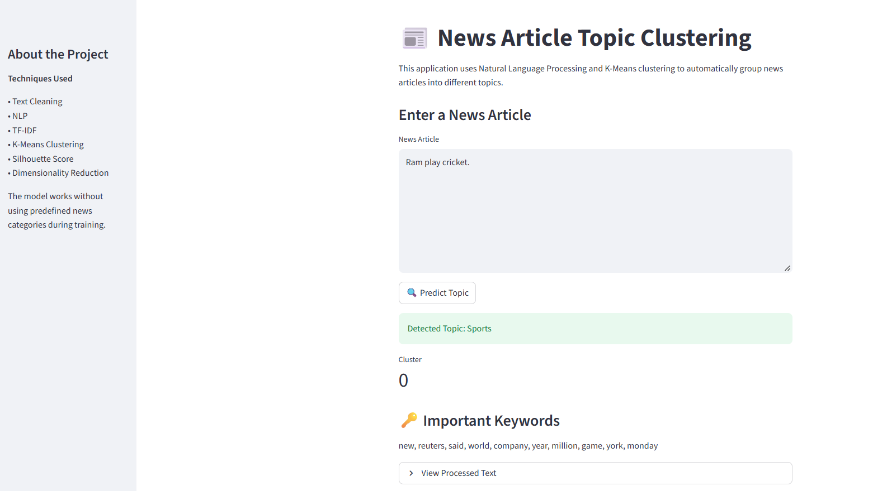

# 📌 News Article Clustering using NLP and Unsupervised Learning

## Project Overview

This project focuses on automatically grouping similar news articles into meaningful topics using Natural Language Processing (NLP) and unsupervised machine learning.

The project uses text cleaning, exploratory data analysis, TF-IDF feature extraction, and K-Means clustering to identify groups of related news articles. It also includes cluster analysis, visualization, and a Streamlit application that allows users to enter a news article and discover its predicted cluster.

## Business Problem

News organizations receive large volumes of articles from different sources every day. Organizing these articles manually into relevant topics can be time-consuming and difficult to manage as the amount of content increases.

The goal of this project is to develop an automated system that groups similar news articles based on their textual content, making it easier to organize and explore large collections of news.

## Project Objectives

- Understand and explore the news article dataset.
- Perform data cleaning and exploratory data analysis.
- Prepare and preprocess text data for NLP.
- Convert text into numerical features using TF-IDF.
- Apply K-Means clustering to group similar articles.
- Identify a suitable number of clusters using the Elbow Method and Silhouette Score.
- Analyze clusters using important keywords and sample articles.
- Visualize the discovered clusters.
- Develop an interactive Streamlit application.

## Streamlit Application

A Streamlit application is developed to make the clustering model interactive.

Users can enter a news article, and the application processes the text and predicts which cluster it belongs to.

### Sample Prediction



## Dataset Description

This project uses the **AG News Dataset**, which contains news articles covering four major topics:

- World
- Sports
- Business
- Sci/Tech

The dataset consists of two CSV files:

| File | Description |
|---|---|
| `train.csv` | Contains 120,000 news articles |
| `test.csv` | Contains 7,600 news articles |

### Dataset Features

| Column | Description |
|---|---|
| `Class Index` | Original numeric category label |
| `Title` | Headline of the news article |
| `Description` | Description or content of the article |

The `Title` and `Description` columns are combined to create the text used for clustering.

**Important:** The `Class Index` column is not used as an input feature during K-Means training. It is kept separately for optional post-clustering comparison with the original categories.

## Project Workflow

1. Data Collection
2. Data Understanding
3. Data Cleaning
4. Text Feature Creation
5. Exploratory Data Analysis (EDA)
6. Text Preprocessing
7. TF-IDF Feature Extraction
8. Choosing the Number of Clusters
9. K-Means Clustering
10. Cluster Analysis
11. Model Evaluation
12. Streamlit Application

## Data Cleaning

Data cleaning is performed to improve the quality and consistency of the dataset.

The main steps include:

- Checking dataset shape and structure.
- Inspecting column names and data types.
- Identifying missing values.
- Checking duplicate records.
- Handling missing text values.
- Combining article titles and descriptions.
- Removing empty text records.
- Checking duplicate articles.

## Exploratory Data Analysis (EDA)

EDA is performed to understand the structure and characteristics of the news articles before applying NLP techniques.

The analysis includes:

- Dataset information and statistical summary.
- Missing-value analysis.
- Duplicate-value analysis.
- Text length distribution.
- Word count distribution.
- Most common words.
- Analysis of text-related features.
- Correlation between numerical text features.

### Data Visualizations

The project includes:

- Histograms
- Boxplots
- Bar charts
- Correlation heatmaps
- Word frequency visualizations
- Cluster visualizations

## Text Preprocessing

Text preprocessing prepares the news articles for feature extraction.

The main preprocessing steps include:

- Converting text to lowercase.
- Removing URLs.
- Removing HTML tags.
- Removing numbers.
- Removing punctuation.
- Removing extra whitespace.
- Removing common stopwords.

The cleaned text is then used for TF-IDF feature extraction.

## TF-IDF Feature Extraction

TF-IDF (Term Frequency-Inverse Document Frequency) is used to convert text into numerical representations that machine learning algorithms can process.

It helps identify important words in news articles based on their frequency and importance across the document collection.

The resulting TF-IDF matrix is used as input for K-Means clustering.

## K-Means Clustering

K-Means is an unsupervised machine learning algorithm used to group similar news articles into clusters.

In this project, the algorithm identifies groups based on similarities in their TF-IDF representations without using predefined category labels during training.

Each article is assigned to a cluster based on its textual features.

## Choosing the Number of Clusters

**Elbow Method**

The Elbow Method examines how the within-cluster sum of squares changes as the number of clusters increases. It helps identify a suitable cluster count.

## Cluster Analysis

After training the K-Means model, the discovered clusters are analyzed to understand their content.

The analysis includes:

- Number of articles in each cluster.
- Important keywords in each cluster.
- Sample articles from each cluster.
- Understanding the main topic represented by each cluster.

The original `Class Index` labels can also be compared with the discovered clusters using cross-tabulation and a heatmap. This comparison is performed only after clustering and is not used to train the model.

## Cluster Visualization

Truncated SVD is used to reduce the high-dimensional TF-IDF feature space into two dimensions.

This allows the discovered clusters to be displayed in a scatter plot, making it easier to observe how articles are grouped.

## Model Evaluation

Since this is an unsupervised learning project, traditional classification accuracy is not the primary evaluation metric.

The project uses:

- Elbow Method.
- Silhouette Score.
- Cluster size analysis.
- Important keyword analysis.
- Sample article inspection.
- Optional comparison with original category labels.

## Streamlit Application

A Streamlit application is developed to make the clustering model interactive.

Users can enter a news article, and the application processes the text and predicts which cluster it belongs to.

### Application Workflow

1. Enter a news article.
2. Clean and preprocess the text.
3. Transform the text using the saved TF-IDF vectorizer.
4. Predict the cluster using the trained K-Means model.
5. Display the predicted cluster and its important keywords.

## Technologies Used

- Python
- Pandas
- NumPy
- Matplotlib
- Seaborn
- Scikit-learn
- Natural Language Processing (NLP)
- TF-IDF
- K-Means Clustering
- Streamlit
- Joblib

## Project Structure

```text
News-Article-Clustering-NLP-Project/
│
├── News Articles Clustering Project PNGs/
│
├── News_Articles_Clustering_Project.ipynb
│
├── app.py
│
├── train.csv
├── test.csv
│
├── tfidf_vectorizer.pkl
├── kmeans_model.pkl
│
└── README.md
```

## How to Run the Project

### 1. Clone the Repository

```bash
git clone https://github.com/ranjansinghds/News-Article-Clustering-NLP-Project.git
```

### 2. Navigate to the Project Directory

```bash
cd News-Article-Clustering-NLP-Project
```

### 3. Install Required Libraries

```bash
pip install pandas numpy matplotlib seaborn scikit-learn streamlit joblib
```

### 4. Run the Streamlit Application

```bash
streamlit run app.py
```

## Real-World Applications

This type of clustering system can be useful for:

- Automatically organizing news articles by topic.
- Helping editors manage large collections of news content.
- Improving news discovery and content exploration.
- Supporting topic-based recommendation systems.
- Grouping similar articles from multiple news sources.

## Future Improvements

- Experiment with DBSCAN and hierarchical clustering.
- Explore advanced text representations such as Word2Vec and Sentence Transformers.
- Improve automatic topic naming.
- Develop article similarity and recommendation features.
- Deploy the application online.

## Conclusion

This project demonstrates how Natural Language Processing and unsupervised machine learning can be used to discover meaningful groups within large collections of news articles. By combining text preprocessing, TF-IDF, K-Means clustering, and cluster analysis, the project provides a practical approach to automatically organizing news content based on textual similarity.